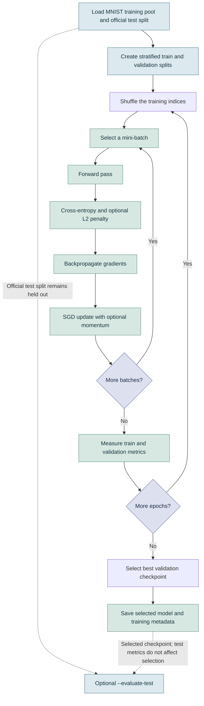

<div align="center">


<h1>MNIST Multilayer Perceptron</h1>

<h3>Understand the network. Follow the math. Build it with NumPy.</h3>

<br>

[](https://www.python.org/)
[](https://numpy.org/)
[](https://streamlit.io/)
[](tests/)
[](LICENSE)

<br>


<p><em>A hands-on study of neural networks, from pixels to predictions.</em></p>

<p align="center">
<a href="#project-overview">Overview</a> ·
<a href="#whats-included">Features</a> ·
<a href="#dataset">Dataset</a> ·
<a href="#how-it-works">How it works</a> ·
<a href="#quick-start">Quick start</a> ·
<a href="#frequently-asked-questions">FAQ</a>
</p>

</div>

---

## Focus

## Project overview

<p align="justify">
This repository is an end-to-end, educational handwritten-digit classification
project. It combines a multilayer perceptron implemented from scratch with an
MNIST data and training pipeline, evaluation tools, guided notebooks, and a
Streamlit app. The full path—from pixel array to prediction—is made visible,
testable, and straightforward to experiment with.
</p>

| Question | Answer |
|:--|:--|
| **What is it?** | A small MNIST classifier whose forward pass, gradients, loss, optimizer, training loop, and evaluation are implemented with NumPy. |
| **Why does it exist?** | To make neural-network mechanics concrete and explore how model and training choices change behavior. |
| **How does it work?** | Normalize pixels, pass them through dense layers, compute a loss, backpropagate gradients, and update parameters with SGD. |
| **Who is it for?** | Learners and educators who want to inspect or modify a compact neural-network implementation. |
| **What do I get?** | A best-validation model artifact, a CLI training pipeline, tests, notebooks, and an interactive app. |

<p align="right"><em>One image in. Ten class scores out. Every step in between is open to inspection.</em></p>

### Why build the model from scratch?

<p align="justify">
High-level machine-learning frameworks make training convenient but can hide
the operations that produce a prediction. This project places the essential
operations in readable NumPy modules, so you can trace the data, inspect
parameters, and compare numerical gradients with finite differences.
TensorFlow/Keras is used only to retrieve MNIST; it does not define or train
the classifier.
</p>

> [!IMPORTANT]
> The goal is to make the learning process inspectable—not to claim that a
> small fully connected network is the best architecture for image
> recognition.

> [!IMPORTANT]
> <mark style="background-color:#B9D7D2;color:#17333D">The model is a learning project first: inspect the implementation, change an experiment, and see how the behavior changes.</mark>

> “A prediction is the end of a computation; understanding the computation is
> the point of this project.”

<u>Model logic: NumPy.</u> Data loading: TensorFlow/Keras. User interface: Streamlit.
~~A hidden framework training loop~~ is not part of the classifier.

### What can I learn or investigate?

| Experiment | Change | Questions to ask |
|:--|:--|:--|
| **Activation** | `relu` ↔ `sigmoid` | How does the activation affect convergence and validation behavior? |
| **Initialization** | `he` ↔ `xavier` | How do starting weight scales affect the first updates? |
| **Architecture** | `128` ↔ `256,128` | What changes when the model gets wider or deeper? |
| **Optimization** | Momentum `0.0` ↔ `0.9` | Does momentum improve progress for this configuration? |
| **Regularization** | L2 `0.0` ↔ `0.001` | How do training and validation metrics compare? |

These are experiments, not guaranteed improvements. Compare validation metrics
and keep the official test set untouched until a configuration is selected.

## What's included

| Area | Details |
|:--|:--|
| **MLP implementation** | Fully connected classifier with ReLU or sigmoid hidden activations, He or Xavier initialization, stable softmax, and cross-entropy loss. |
| **Training** | Mini-batch SGD with optional momentum and L2 regularization; seeded parameter initialization, deterministic shuffling, stratified train/validation splitting, and restoration of the best-validation checkpoint. |
| **Evaluation** | Aggregate loss and accuracy, confusion matrix, per-class precision/recall/F1, and per-example predictions and probabilities. |
| **Digit prediction** | Upload up to 20 PNG, JPEG/JFIF, BMP/DIB, GIF, TIFF, or WebP images per batch; inspect predictions in 3D probability and image-quality views, and export results as CSV. Unsupported or invalid files are reported without blocking valid images. |
| **Image quality tools** | Detect soft edges, compare original and sharpened crops as 3D surfaces, and optionally apply adjustable sharpening before inference. |
| **Interactive visuals** | Explore 3D network architecture, pixel-intensity terrain, weight surfaces, a batch probability cloud, a batch-quality map, and an animated 3D forward pass driven by an image's actual activations. |
| **Model explainability** | Inspect network architecture, learned weight patterns, first-layer and output-weight surfaces, and an available saved three-dimensional loss landscape. |
| **Training & experiments** | Generate reproducible training commands, filter and compare validation runs, and export selected comparisons. |
| **Model benchmark** | Measure median inference latency and throughput by batch size, and inspect parameter memory, model artifact size, and estimated multiply-accumulate operations. |
| **Shared sidebar** | Select the saved model used by inference and inspection, view its validation accuracy and selected checkpoint epoch when recorded, tune 3D neuron detail and animation speed, and open the developer portfolio. |
| **Notebooks** | Data exploration, a from-scratch MLP, training experiments, interpretability, and 3D loss-landscape analysis. |

<div align="center">


</div>

## Dataset

The project uses the [MNIST handwritten-digit
dataset](https://keras.io/api/datasets/mnist/), loaded through
`tensorflow.keras.datasets.mnist`.

<p align="justify">
Why MNIST? Its small images and ten familiar classes make it possible to
visualize inputs, inspect model behavior, and run experiments on a personal
computer without a specialized accelerator. It is a useful teaching benchmark,
but it is not representative of every handwriting style, document layout, or
real-world vision task.
</p>

| Property | Details |
|:--|:--|
| **Training pool** | 60,000 labeled images |
| **Official test split** | 10,000 labeled images |
| **Image format** | 28 × 28 grayscale pixels, originally stored as `uint8` values from 0 to 255 |
| **Labels** | Integer digit classes from 0 through 9 |
| **Default validation split** | 5,000 examples stratified from the training pool; 55,000 remain for training |
| **Cache** | Keras local dataset cache; the data is not copied into the repository |

Before entering the model, images are converted to `float32`, scaled to the
`[0, 1]` range, and flattened to 784 features. The uploaded-image page also
thresholds, crops, resizes, and centers a digit on a 28 × 28 canvas.

> [!CAUTION]
> Keep the official test split out of training and model selection. Use the
> validation split to compare configurations; evaluate on the test split only
> after choosing a model. The CLI's `--evaluate-test` option evaluates the
> selected best-validation checkpoint once; test results do not affect selection.

## How it works

### Classifier path

The default CLI architecture is **784 → 128 → 10**: 784 input features, one
hidden layer with 128 units, and 10 output classes. It contains 101,770
trainable parameters. Change `--hidden-dims` to experiment with deeper or
wider networks.

```mermaid
flowchart LR
    X["28 × 28 grayscale image"] --> P["Normalize to [0, 1] and flatten"]
    P --> H1["784 × hidden width 1 affine layer"]
    H1 --> A1["ReLU or sigmoid hidden activation"]
    A1 --> HN["Optional additional hidden layers"]
    HN --> O["10-class output logits"]
    O --> S["Stable row-wise softmax"]
    S --> Y["Highest-probability digit"]

    classDef data fill:#DCE9EE,stroke:#527F94,color:#17333D
    classDef layer fill:#D7E8E2,stroke:#5F8F7A,color:#17333D
    classDef output fill:#DDE1EF,stroke:#6675A8,color:#1C2942
    class X,P data
    class H1,A1,HN layer
    class O,S,Y output
```



For a batch, each affine layer computes a weighted sum plus bias. Hidden layers
apply ReLU or sigmoid; the output layer produces logits. Stable softmax maps
the logits to class probabilities. Cross-entropy is computed from logits
directly to avoid unnecessary numerical instability.

### Training flow



The backward pass computes the gradients of the batch loss with respect to
weights and biases. SGD applies the update; optional momentum accumulates
updates, and L2 regularization penalizes large weights. Training and validation
metrics are measured after each epoch.

After the final epoch, the training script selects the checkpoint with the
highest validation accuracy; when accuracy ties, it selects the lower
validation loss. The saved model parameters come from that selected epoch, while
the training history and console output retain metrics for every epoch. Artifact
metadata records `best_epoch`, `best_validation_accuracy`, and
`best_validation_loss`.

<p align="left">
<strong>Why separate train, validation, and test data?</strong> The training
split updates weights, the validation split helps compare settings, and the
test split is reserved for a final check. Reusing the test set while tuning can
make its score less representative of performance on unseen examples.
</p>

> [!NOTE]
> The official test split is kept separate from training and validation.
> Evaluate it only after selecting the model configuration.

### Default training settings

| Setting | Default | CLI option |
|:--|:--|:--|
| Hidden layers | `128` | `--hidden-dims 256,128` |
| Activation | ReLU | `--activation relu` or `sigmoid` |
| Initialization | He | `--initialization he` or `xavier` |
| Epochs | 10 | `--epochs 20` |
| Batch size | 128 | `--batch-size 128` |
| Learning rate | 0.1 | `--learning-rate 0.05` |
| Momentum | 0.0 (disabled) | `--momentum 0.9` |
| L2 strength | 0.0 (disabled) | `--l2-strength 0.001` |
| Validation examples | 5,000 | `--validation-size 5000` |
| Random seed | 42 | `--seed 42` |

## Data, training & artifacts

MNIST is retrieved through Keras and stored in its local cache. The helper
`scripts/download_data.py` validates and preloads the dataset; the training
script also loads it automatically if needed.

Training uses the NumPy implementation and saves the best-validation model
parameters, architecture, and run metadata (including the seed,
`best_epoch`, `best_validation_accuracy`, and `best_validation_loss`) to
`models/mnist_mlp.npz`. The repository includes a trained artifact so the app
can be tried before retraining. Retrain the model to reproduce an experiment
or test a different configuration.

Run the notebooks in this order:

`00_Data_Exploration` → `01_MLP_From_Scratch` → `02_Training_Experiments` →
`03_Interpretability` → `04_3D_Loss_Landscape`

The notebooks are complementary explorations; the CLI training workflow is
the reproducible path for producing the app's model artifact.

### What happens when I use the app?

1. The Home page loads the saved model and displays its architecture,
   validation accuracy, and recorded test status. New CLI artifacts report
   the best-validation checkpoint; older artifacts may report their final epoch.
2. The prediction page accepts up to 20 PNG, JPEG/JFIF, BMP/DIB, GIF, TIFF, or
   WebP images (up to 5 MB each), prepares each as a centered 28 × 28 input, and
   reports the top three classes. Unsupported or unreadable files trigger a
   notification and are skipped while valid files continue.
3. Review the 3D batch-quality and class-probability views plus the selected
   image's pixel terrain; optionally flag lower-scoring results for manual
   review; and download the prediction table as CSV. Select any valid image to
   compare its original and sharpened crops when soft edges are detected, then
   animate its sampled activations through the 3D network.
4. Model Explainability visualizes the architecture, learned weights, and
   available saved loss landscape.
5. Training & Experiments generates CLI commands and compares an uploaded or
   saved CSV of validation results.
6. Model Benchmark measures inference latency and throughput using deterministic
   synthetic inputs on the machine serving the app.

The app loads the saved artifact; **it does not train a model when it starts**.
Training is run separately from the command line.

## Repository map

| Path | Purpose |
|:--|:--|
| `src/` | NumPy model, activations, data preparation, losses, optimizer, training, evaluation, and visualization modules |
| `app.py` | Streamlit home page |
| `pages/` | Prediction Studio, Model Explainability, Training & Experiments, and Model Benchmark |
| `scripts/` | Dataset download/validation and CLI training |
| `tests/` | Gradient checks, model serialization, and direct-command regression tests |
| `notebooks/` | Guided data, training, and interpretability experiments |
| `models/mnist_mlp.npz` | Included model artifact and metadata; CLI training saves the best-validation checkpoint |
| `reports/figures/` | Generated loss-landscape data and visualizations, when saved |

## Using the model API

The main class is `src.model.NumpyMLP`. Inputs are numeric batches with shape
`(N, input_dim)`; for MNIST, preprocess raw 28 × 28 pixels to `float32` values
in `[0, 1]` before passing them to the model.

| Method | Purpose | Result |
|:--|:--|:--|
| `forward(X)` | Run the affine layers and hidden activations | Output logits and a cache for backpropagation |
| `loss(X, labels)` | Calculate mean cross-entropy, optionally with L2 regularization | Scalar loss |
| `backward(labels, cache)` | Calculate gradients for weights and biases | Dictionary keyed by parameter name |
| `predict_proba(X)` | Convert output logits into class probabilities | Array shaped `(N, output_dim)` |
| `predict(X)` | Select the highest-scoring class per example | Integer class IDs |
| `save(path, metadata=...)` / `NumpyMLP.load(path)` | Persist and restore a model | Compressed `.npz` artifact |

Saved artifacts contain the architecture, activation and initialization names,
weight and bias arrays, and optional scalar metadata. CLI-trained artifacts
record `best_epoch`, `best_validation_accuracy`, and `best_validation_loss`;
their parameters are from that selected epoch. Loading uses NumPy's non-pickle
mode.

## Comparing experiment results

Training & Experiments reads either an uploaded CSV or `reports/experiments.csv`.
Required columns are `name`, `group`, `val_accuracy`, and `val_loss`.
Validation accuracy must be between 0 and 1; validation loss must be
non-negative. Optional columns include `hidden_dims`, `activation`,
`initialization`, `parameters`, `batch_size`, and `seconds`.

```csv
name,group,val_accuracy,val_loss,hidden_dims,activation,initialization,parameters,batch_size,seconds
relu-baseline,activation,0.965,0.12,128,relu,he,101770,128,42.5
sigmoid-baseline,activation,0.951,0.17,128,sigmoid,xavier,101770,128,44.1
```

These example metrics illustrate the CSV format only; results depend on the
artifact, configuration, and runtime environment.

## Quick start

Requires **Python 3.11, 3.12, or 3.13**. From the repository root, create a
virtual environment and install the runtime package:

```powershell
python --version
python -m venv .venv
.\.venv\Scripts\Activate.ps1
python -m pip install --upgrade pip
python -m pip install -r requirements.txt
```

Start the Streamlit app:

```powershell
python -m streamlit run app.py
```

For training, notebooks, testing, and linting, install the additional
development dependencies:

```powershell
python -m pip install -r requirements-train.txt
python scripts/download_data.py
python scripts/train.py --epochs 10
```

Try a different architecture and optimizer configuration:

```powershell
python scripts/train.py `
  --hidden-dims "256,128" `
  --activation relu `
  --initialization he `
  --epochs 20 `
  --batch-size 128 `
  --learning-rate 0.05 `
  --momentum 0.9 `
  --l2-strength 0.001 `
  --seed 42
```

By default, the best-validation checkpoint is saved to `models/mnist_mlp.npz`.
Use `--output PATH` to choose a different artifact path. Add
`--evaluate-test` to evaluate that selected checkpoint once on the official,
held-out test set after model selection; test results do not affect checkpoint
selection.

> [!TIP]
> Run commands from the repository root and use the same Python interpreter
> for installing dependencies and launching the app or scripts.

## Reproducibility & evaluation

The default seed (`42`) controls model initialization, the stratified
train/validation split, and mini-batch shuffling. The seed and selected
checkpoint's epoch, validation accuracy, and validation loss are saved in
artifact metadata. The same seed makes the data and initialization choices
repeatable; small numeric differences can still occur across library versions
or hardware.

The test suite includes finite-difference checks for gradients, cross-entropy
reduction checks, a model save/load round trip, and direct-script invocation
checks. Run `python -m pytest` to execute them.

Training records train and validation loss/accuracy after every epoch in its
console output. The saved `.npz` artifact contains the best-validation
checkpoint's model parameters, architecture, and selected run metadata. The
Streamlit UI labels output probabilities as model scores because they are
**not calibrated confidence estimates**.

## Development

```powershell
python -m pytest
python -m ruff check .
python tests/test_model.py
```

The modules live directly in `src/` and are imported as `src.*`. In VS Code,
open the repository root and select the project's `.venv` interpreter so
Pylance and the integrated terminal use the same environment.

## Scope & limitations

- The classifier is a small, fully connected baseline for learning and
  experimentation; it is not a production-grade computer-vision system.
- The prediction page expects one digit per image and transforms it to resemble
  MNIST input. Each batch accepts up to 20 PNG, JPEG/JFIF, BMP/DIB, GIF, TIFF,
  or WebP images, with a 5 MB per-image limit. Documents and other non-image
  files are not accepted. Handwriting style, positioning, contrast, blur, and
  preprocessing can affect results. Automatic sharpening is a visual heuristic
  and cannot recover detail lost during capture.
- Displayed class probabilities are model outputs, **not calibrated
  confidence estimates**.
- This project focuses on classification, not deployment at scale, GPU
  acceleration, or live data ingestion.

## Frequently asked questions

<details>
<summary><strong>Do I need TensorFlow to run the app?</strong></summary>

No. The runtime install contains NumPy, Streamlit, and the visualization and
image dependencies. TensorFlow is part of `requirements-train.txt` because it
provides the MNIST dataset loader.

</details>

<details>
<summary><strong>Does the app train or download data on startup?</strong></summary>

No. It loads the included model artifact. Dataset download and model training
are separate CLI operations.

</details>

<details>
<summary><strong>Can I use my own digit image?</strong></summary>

Yes. Upload a PNG, JPEG/JFIF, BMP/DIB, GIF, TIFF, or WebP containing one digit.
Other file types, including Word documents and PDFs, are not accepted. The page
converts images to grayscale, crops and centers the foreground, and scales it
to the model input. Images are limited to 5 MB and large decoded dimensions are
rejected. An invert option is available for dark ink on a light background.
Soft edges are detected and can be gently sharpened before inference; this
heuristic cannot recreate details absent from the source image.

</details>

<details>
<summary><strong>Why use a fully connected network instead of a CNN?</strong></summary>

A fully connected network is smaller and easier to trace for this educational
goal: every layer's matrix operations and gradients are visible in the NumPy
code. CNNs are a natural next step for image data, but would add architectural
complexity beyond the project's focus.

</details>

<details>
<summary><strong>Can I use this model for other image datasets?</strong></summary>

Not directly. The training and evaluation pipeline validates MNIST-shaped
images and ten classes. A different task needs compatible preprocessing,
labels, output dimensions, and evaluation data.

</details>

<details>
<summary><strong>Where is the MNIST dataset stored?</strong></summary>

The Keras loader stores the dataset in its local cache. The repository does not
copy the raw dataset into its source tree.

</details>

<details>
<summary><strong>Why are the displayed probabilities not called confidence?</strong></summary>

Softmax outputs sum to one, but that alone does not mean they are calibrated
probabilities of correctness. Treat them as model scores.

</details>

## License

This project is distributed under the [MIT License](LICENSE).